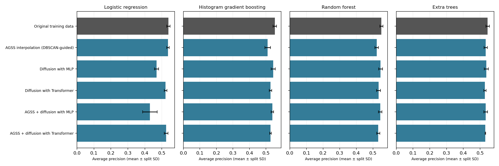

# Synthetic credit-card data: generation and model comparison

## What was done

We used only `UCI_Credit_Card.csv`: 30,000 customer records, 23 features and the next-month-default label. We generated training data using AGSS interpolation and diffusion, with DBSCAN guidance and MLP/Transformer backbones, then compared models trained on those datasets against models trained on the original data.

This run trained the models from the original credit-card CSV.

The comparison contains **5 generation methods**, **5 train/validation/test splits**, and **four prediction models**. There are **120 model fits** and **240 result rows** covering two decision thresholds.

## How the datasets were generated

- **AGSS interpolation:** DBSCAN groups training defaults; nearby records within retained groups are interpolated. Categorical values come from the source records.
- **Diffusion + MLP:** a diffusion model learns to remove noise using an MLP.
- **Diffusion + Transformer:** the denoiser uses a separate token for each feature.
- **AGSS + diffusion + MLP:** the generator learns from DBSCAN-retained defaults and receives cluster labels.
- **AGSS + diffusion + Transformer:** the same cluster guidance with a Transformer denoiser.

For each split, we kept all original training records and generated extra defaults to balance defaults and non-defaults. `synthetic.csv.gz` contains the generated default rows; `training.csv.gz` contains the complete two-class training dataset used for the comparison. The original-data baseline has no generated rows.

| Method | Datasets | Generated rows (min) | Generated rows (max) |
| --- | --- | --- | --- |
| Original training data | 5 | 0 | 0 |
| AGSS interpolation (DBSCAN-guided) | 5 | 9987 | 10179 |
| Diffusion with MLP | 5 | 9987 | 10179 |
| Diffusion with Transformer | 5 | 9987 | 10179 |
| AGSS + diffusion with MLP | 5 | 9987 | 10179 |
| AGSS + diffusion with Transformer | 5 | 9987 | 10179 |

The code uses the TabDDPM diffusion loss core with project-specific sampling/backbone choices. AGSS's mixed-feature interpolation is also a stated adaptation; these are not claims of reproducing published results exactly. Transformer was chosen from the requested Transformer-or-Mamba option.

## How performance was checked

The same real data partitions were used for every method in a split: approximately 60% training, 20% validation and 20% testing. Identical feature rows stay in one partition. Generated records enter training only. Preprocessing and generation learn from training records; validation chooses density settings, the diffusion checkpoint and the F1 cutoff. Test records are used for the reported scores.

The prediction models are logistic regression, gradient boosting, random forest and extra trees. **Average precision (AP)** measures how well defaults rise to the top of the risk ranking. **Precision** measures how many flagged cases really default; **recall** measures how many defaults are caught; **F1** balances precision and recall. Higher is better for these scores. ROC-AUC is a complementary ranking measure; accuracy counts overall correct decisions; balanced accuracy gives the two classes equal weight. Results at cutoff 0.5 are also saved in the CSV.

[Metric definitions and reasons](METRICS.md) give the formula, positive class, cutoff dependence and exact source of every measure. [Evidence and a worked example](EVIDENCE.md) trace the numbers back to individual real test records.

## Results

The table below keeps the classifier fixed at histogram gradient boosting so that it compares the training datasets directly. Values are means across the splits. The ± value for AP is the sample standard deviation over the 5 split scores (ddof=1), not a confidence interval. Other displayed scores are means; their standard deviations are also in `comparison_summary.csv`. The 5 source evidence IDs behind every reported mean and SD are listed in `summary_evidence.csv`.

| Method | AP | AUC | F1 | Precision | Recall | Accuracy | Balanced_accuracy |
| --- | --- | --- | --- | --- | --- | --- | --- |
| Diffusion with MLP | 0.5439 ± 0.0123 | 0.7818 | 0.5419 | 0.5073 | 0.5828 | 0.7827 | 0.7111 |
| Diffusion with Transformer | 0.5276 ± 0.0079 | 0.7682 | 0.5218 | 0.5108 | 0.5376 | 0.7831 | 0.6949 |
| Original training data | 0.5533 ± 0.0105 | 0.7805 | 0.5415 | 0.5223 | 0.5642 | 0.7897 | 0.7088 |
| AGSS + diffusion with MLP | 0.5389 ± 0.0075 | 0.7794 | 0.5379 | 0.5124 | 0.5666 | 0.7851 | 0.7068 |
| AGSS + diffusion with Transformer | 0.5272 ± 0.0051 | 0.7631 | 0.5244 | 0.4883 | 0.5681 | 0.7727 | 0.6994 |
| AGSS interpolation (DBSCAN-guided) | 0.5102 ± 0.0169 | 0.7526 | 0.5075 | 0.4519 | 0.5809 | 0.7511 | 0.6900 |

Across the four classifiers, **0 of 20 generation-method/classifier combinations improved mean AP** over their matching original-data baseline. The strongest original-data result was Histogram gradient boosting at AP **0.5533**. Small F1 changes should be read alongside AP: changing the decision cutoff can improve F1 without improving the ranking.

All four classifiers are listed in [the full comparison](COMPARISON.md). Per-split values are in `metrics.csv`, and `paired_differences.csv` subtracts each classifier's original-data result on the same split. `metric_evidence.csv` provides the exact formula, substituted counts, source prediction/model/training files, hashes and CSV line for each individual score.

## Files and checks

The results are in `results/credit_card`. `dataset_inventory.csv` lists the generated and complete training files. Each method directory also contains its fitted classifier files, generator weights/schema where applicable, selected-checkpoint information and saved validation/test predictions.

Verification replayed 120 saved classifiers and recomputed 240 result rows. Validation selection scores, the batch-to-epoch training-loss totals, observed timing intervals and fitted classifier parameters were also checked. `run.json` records the command, settings, library versions, start/end times and frozen fitting source.

This accepted run contains 2640 individual metric values, 55 validation-selection scores and 168 aggregate score entries with evidence links. Counts and time fields are explained separately in `metadata_evidence.csv`. Training loss is an optimization trace, not a test-performance score.

These findings apply to this dataset and these settings. The real test rows were excluded from fitting and setting selection in this run, but the same dataset and split scheme have been examined during earlier iterations; this is exploratory evidence, not a new untouched confirmation cohort. Repeated splits overlap, so their standard deviation is descriptive. The comparison does not establish that any method will improve every credit-risk dataset.
